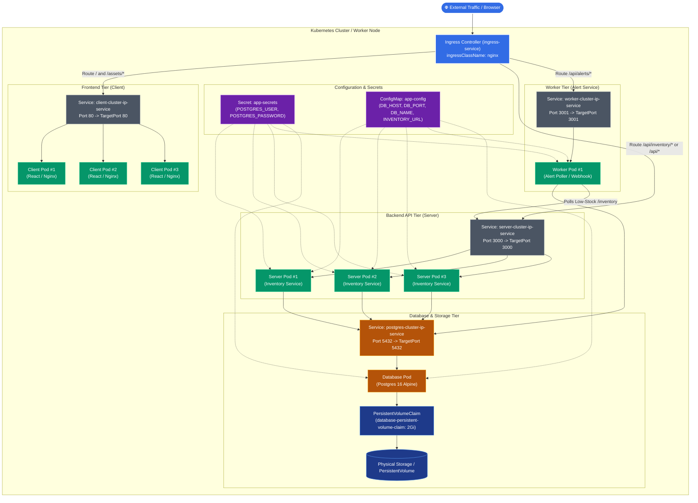
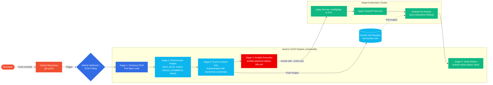

# Smart Inventory Management System — Production DevOps Architecture & Runbook

This document details the production-ready Kubernetes architecture, Ansible automation, and Jenkins CI/CD pipeline implemented for the **Smart Inventory Management System**, following the complete instructor specifications and architectural patterns.

---

## 1. Kubernetes Architecture (Node & Pod Topography)

The architecture represents a scalable, decoupled microservices topology deployed on a Kubernetes cluster. External traffic enters through an **NGINX Ingress Controller**, which terminates routing and forwards requests internally to designated **ClusterIP Services**. The services distribute load across replicated application pods.



---

## 2. End-to-End CI/CD Pipeline Architecture

The automated delivery pipeline connects developer commits to zero-downtime Kubernetes rollouts using **Jenkins**, **Docker Hub**, and **Ansible**.



---

## 3. Directory Structure & File Map

```
smart-inventory/
├── Jenkinsfile                             # Declarative Jenkins CI/CD pipeline
├── DEVOPS_ARCHITECTURE.md                  # System design & complete runbook
├── docker-compose.yml                      # Production stack with consistent image tags
├── docker-compose.dev.yml                  # Local development compose file
├── .env.example                            # Template for environment overrides
│
├── k8s/                                    # Kubernetes manifests
│   ├── secret.yaml                         # PostgreSQL database credentials
│   ├── configmap.yaml                      # Non-sensitive app config & service URLs
│   ├── database-persistent-volume-claim.yaml # 2Gi ReadWriteOnce database storage
│   ├── postgres-cluster-ip-service.yaml    # DB ClusterIP service (port 5432)
│   ├── postgres-deployment.yaml            # Postgres 16 Alpine deployment (1 replica)
│   ├── server-cluster-ip-service.yaml      # Backend ClusterIP service (port 3000)
│   ├── server-deployment.yaml              # Inventory API deployment (3 replicas)
│   ├── worker-cluster-ip-service.yaml      # Worker ClusterIP service (port 3001)
│   ├── worker-deployment.yaml              # Alert poller service (1 replica)
│   ├── client-cluster-ip-service.yaml      # Frontend ClusterIP service (port 80)
│   ├── client-deployment.yaml              # React Nginx deployment (3 replicas)
│   └── ingress-service.yaml                # NGINX Ingress rules & regex rewrites
│
├── ansible/                                # Ansible automation
│   ├── ansible.cfg                         # Ansible configuration & defaults
│   ├── inventory.ini                       # Inventory for localhost & remote VMs
│   └── playbooks/
│       ├── setup-environment.yml           # Host provisioning (Docker, kubectl, Ingress)
│       └── deploy-k8s.yml                  # Automated K8s deployment & rollout playbook
│
├── frontend/                               # React + Vite client
├── inventory-service/                      # Node.js + Express + Postgres backend
└── alert-service/                          # Node.js alert poller & webhook service
```

---

## 4. Docker Hub Placeholder Replacement Guide

All manifests and pipeline files use the standardized placeholder:
`<DOCKERHUB_USERNAME>`

Before pushing to your registry, replace `<DOCKERHUB_USERNAME>` with your actual Docker Hub username (e.g. `johndoe`) in the following files:

| File | Line / Location | Purpose |
|---|---|---|
| `Jenkinsfile` | `DOCKERHUB_USERNAME = '<DOCKERHUB_USERNAME>'` | Injected into build and push commands |
| `docker-compose.yml` | `image: <DOCKERHUB_USERNAME>/...` | Matches compose builds to registry tags |
| `k8s/client-deployment.yaml` | `image: <DOCKERHUB_USERNAME>/smart-inventory-client:latest` | Frontend container image |
| `k8s/server-deployment.yaml` | `image: <DOCKERHUB_USERNAME>/smart-inventory-server:latest` | Backend API container image |
| `k8s/worker-deployment.yaml` | `image: <DOCKERHUB_USERNAME>/smart-inventory-worker:latest` | Alert service container image |
| `ansible/playbooks/deploy-k8s.yml` | `dockerhub_username: "<DOCKERHUB_USERNAME>"` | Fallback variable when not passed from CI |

> **Pro Tip (One-Liner Search & Replace)**:
> ```bash
> export DH_USER="your-dockerhub-username"
> sed -i "s/<DOCKERHUB_USERNAME>/$DH_USER/g" Jenkinsfile docker-compose.yml k8s/*.yaml ansible/playbooks/deploy-k8s.yml
> ```

---

## 5. Step-by-Step Execution & Verification Guide

### Step 5.1: Test with Docker Compose (Local Sanity Check)

Before deploying to Kubernetes, verify the containerized services build and interact locally:

```bash
# 1. Build and start all services in detached mode
docker compose up -d --build

# 2. Check running container status
docker compose ps

# 3. Verify health checks
curl -f http://localhost:8080/healthz     # Frontend Nginx healthcheck
curl -f http://localhost:3000/health      # Inventory API healthcheck
curl -f http://localhost:3001/health      # Alert Service healthcheck

# 4. Tear down containers when finished
docker compose down
```

---

### Step 5.2: Setup Kubernetes Cluster & Enable Ingress

You can run this architecture on **Minikube**, **Docker Desktop**, **K3s**, or a remote **Linux VM / cloud cluster**.

#### Option A: Minikube
```bash
# Start Minikube (e.g. with docker driver)
minikube start --driver=docker

# Enable the NGINX Ingress Controller addon
minikube addons enable ingress

# Verify ingress controller pod is running
kubectl get pods -n ingress-nginx -l app.kubernetes.io/component=controller
```

#### Option B: Docker Desktop Kubernetes / Generic Cluster
```bash
# Install the official NGINX Ingress Controller
kubectl apply -f https://raw.githubusercontent.com/kubernetes/ingress-nginx/controller-v1.10.0/deploy/static/provider/cloud/deploy.yaml

# Wait until the controller pod reports Ready
kubectl wait --namespace ingress-nginx \
  --for=condition=ready pod \
  --selector=app.kubernetes.io/component=controller \
  --timeout=120s
```

---

### Step 5.3: Run Ansible Environment Setup

The provisioning playbook `ansible/playbooks/setup-environment.yml` verifies or installs Docker, `kubectl`, Python dependencies, and the Ingress Controller on your target machine:

```bash
# 1. Install Ansible (if not already installed on control machine)
# Ubuntu/Debian: sudo apt-get update && sudo apt-get install -y ansible
# Fedora/RHEL:   sudo dnf install -y ansible

# 2. Run the environment provisioning playbook
ansible-playbook -i ansible/inventory.ini ansible/playbooks/setup-environment.yml --ask-become-pass
```

> **Targeting a Remote Linux VM**:
> Edit `ansible/inventory.ini` and specify your VM's IP address, user, and SSH private key:
> ```ini
> [k8s_nodes]
> remote-k8s-node ansible_host=192.168.1.100 ansible_user=ubuntu ansible_ssh_private_key_file=~/.ssh/id_rsa ansible_python_interpreter=/usr/bin/python3
> ```

---

### Step 5.4: Deploy to Kubernetes Manually via Ansible

You can execute the deployment playbook directly without Jenkins to test the rollout:

```bash
ansible-playbook -i ansible/inventory.ini ansible/playbooks/deploy-k8s.yml \
  --extra-vars "image_tag=latest dockerhub_username=your-dockerhub-username"
```

The playbook executes the following phases in strict dependency order:
1. Applies `secret.yaml`, `configmap.yaml`, and `database-persistent-volume-claim.yaml`.
2. Applies all ClusterIP services: `postgres-cluster-ip-service`, `server-cluster-ip-service`, `worker-cluster-ip-service`, `client-cluster-ip-service`.
3. Applies all deployments: `postgres-deployment`, `server-deployment`, `worker-deployment`, `client-deployment`.
4. Applies `ingress-service.yaml`.
5. Updates container images to the specified tag.
6. Triggers `kubectl rollout restart` and monitors `kubectl rollout status` until all pods reach a healthy state.
7. Prints a summary of running pods, services, and ingress rules.

---

### Step 5.5: Configure Jenkins CI/CD Pipeline

To enable automated push-to-deploy:

#### 1. Jenkins Plugins
Ensure the following standard Jenkins plugins are installed (**Manage Jenkins** -> **Plugins**):
- **Pipeline** (Workflow Aggregator)
- **Git Plugin**
- **Docker Pipeline** / **Docker Plugin**
- **Credentials Binding Plugin**
- **Ansible Plugin** (optional, pipeline uses shell execution which works natively)

#### 2. Docker Hub Credentials
1. Go to **Manage Jenkins** -> **Credentials** -> **System** -> **Global credentials** -> **Add Credentials**.
2. **Kind**: `Username with password`.
3. **Scope**: `Global`.
4. **Username**: Your Docker Hub username.
5. **Password**: Your Docker Hub Personal Access Token (PAT) or password.
6. **ID**: `dockerhub-credentials` *(Must match the ID defined in `Jenkinsfile`)*.
7. Click **Create**.

#### 3. Create Pipeline Job
1. In Jenkins dashboard, click **New Item**.
2. Enter item name: `smart-inventory-pipeline`.
3. Select **Pipeline** and click **OK**.
4. In the **Build Triggers** section:
   - Check **GitHub hook trigger for GITScm polling** (for webhooks), OR
   - Check **Poll SCM** and enter `H/5 * * * *` (polls GitHub every 5 minutes).
5. In the **Pipeline** section:
   - **Definition**: `Pipeline script from SCM`.
   - **SCM**: `Git`.
   - **Repository URL**: `https://github.com/<your-account>/smart-inventory.git`.
   - **Branch Specifier**: `*/main` or `*/master`.
   - **Script Path**: `Jenkinsfile`.
6. Click **Save**.

#### 4. GitHub Webhook Setup
1. In your GitHub repository, navigate to **Settings** -> **Webhooks** -> **Add webhook**.
2. **Payload URL**: `http://<YOUR_JENKINS_SERVER_IP>:8080/github-webhook/`.
3. **Content type**: `application/json`.
4. **Which events**: `Just the push event`.
5. Click **Add webhook**.

Whenever a developer pushes code to GitHub:
1. Jenkins pulls the commit.
2. Builds the three container images tagged with `${BUILD_NUMBER}` and `latest`.
3. Pushes the images to Docker Hub.
4. Invokes Ansible to update Kubernetes deployment images and rollout new pods.
5. Verifies all replicas are healthy and reports build success!

---

## 6. Verification and Troubleshooting Commands

### Inspect Cluster Resources
```bash
# Check all resources created for the project
kubectl get all,pvc,ingress -l app=smart-inventory

# Check individual pod logs
kubectl logs -l component=server -f --tail=50
kubectl logs -l component=worker -f --tail=50
kubectl logs -l component=client -f --tail=50
kubectl logs -l component=postgres -f --tail=50
```

### Ingress & Application Testing
```bash
# Determine Ingress IP / Host
kubectl get ingress ingress-service

# For Minikube:
# Run in a separate terminal: minikube tunnel
# Or test directly via Minikube IP:
export INGRESS_HOST=$(minikube ip)

# 1. Test Client Frontend Route (returns HTML index)
curl -i http://${INGRESS_HOST:-localhost}/

# 2. Test Inventory Service API via Ingress (returns JSON items)
curl -i http://${INGRESS_HOST:-localhost}/api/inventory/items

# 3. Test Alerts API via Ingress (returns JSON alerts)
curl -i http://${INGRESS_HOST:-localhost}/api/alerts/alerts

# 4. Trigger alert scan
curl -X POST http://${INGRESS_HOST:-localhost}/api/alerts/alerts/check
```

### Rollout Troubleshooting
```bash
# View rollout history
kubectl rollout history deployment/client-deployment
kubectl rollout history deployment/server-deployment

# Undo a faulty rollout
kubectl rollout undo deployment/client-deployment
kubectl rollout undo deployment/server-deployment

# Inspect recent cluster events
kubectl get events --sort-by=.metadata.creationTimestamp
```
