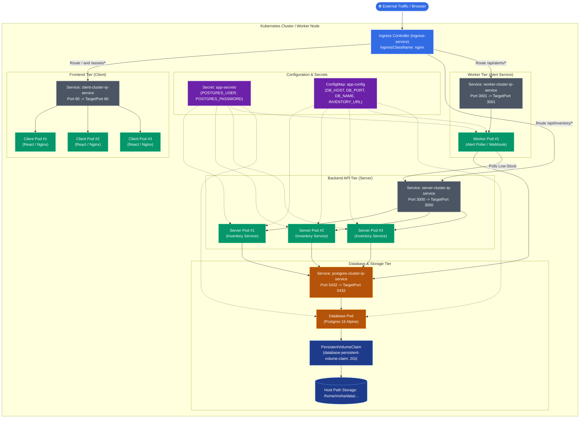

# Smart Inventory Management System — Complete Project Presentation

> **Author**: Mohamed (`Moha-sys`)  
> **Course / Program**: NTI Continuous Integration & Continuous Delivery (CI/CD) and Cloud Native DevOps  
> **Repository**: [https://github.com/Moha-sys/smart-inventory](https://github.com/Moha-sys/smart-inventory)  
> **Docker Hub**: [https://hub.docker.com/u/mohadevv](https://hub.docker.com/u/mohadevv)  
> **Jenkins Pipeline Job**: `http://localhost:8080/job/smart-inventory/`  

---

## Slide 1: Executive Summary & Project Objectives

```
+---------------------------------------------------------------------------------------------------------------+
|                               SMART INVENTORY MANAGEMENT SYSTEM - DEVOPS ARCHITECTURE                         |
|                                                                                                               |
|   +-----------------------+     +-----------------------+     +--------------------+     +-----------------+  |
|   |  Dockerized Services  | --> |  Kubernetes Cluster   | --> | Ansible Automation | --> |  Jenkins CI/CD  |  |
|   |  - React SPA (Nginx)  |     |  - Ingress Controller |     | - Host Setup Play  |     |  - GitHub Webhook|  |
|   |  - Node Inventory API |     |  - 3x Client Replicas |     | - K8s Deploy Play  |     |  - Multi-Docker |  |
|   |  - Node Alert Worker  |     |  - 3x Server Replicas |     | - Dynamic Tagging  |     |  - Hub Registry |  |
|   |  - Postgres 16 DB     |     |  - 1x Worker Replica  |     | - Zero Downtime    |     |  - Auto Rollout |  |
|   |  - Persistent Storage |     |  - 1x DB + 2Gi PVC    |     | - Idempotent Steps |     |  - Health Probes|  |
|   +-----------------------+     +-----------------------+     +--------------------+     +-----------------+  |
+---------------------------------------------------------------------------------------------------------------+
```

### Core Objectives Achieved
1. **Microservices Decoupling**: Separated monolithic logic into dedicated services (`frontend`, `inventory-service`, `alert-service`, and `postgres`).
2. **Kubernetes Orchestration**: Built production manifests with high availability (`replicas: 3`), internal `ClusterIP` isolation, and unified `Ingress` routing.
3. **Data Persistence**: Configured decoupled `PersistentVolume` and `PersistentVolumeClaim` ensuring database persistence across pod recreation.
4. **Ansible Automation**: Automated host provisioning and rolling Kubernetes deployments with zero manual YAML editing.
5. **Continuous Delivery (CI/CD)**: Engineered an automated Jenkins pipeline that triggers on GitHub push, builds multi-service container images, publishes to Docker Hub, and completes zero-downtime rolling updates.

---

## Slide 2: Microservices Architecture & Docker Compose Verification

```
+-----------------------------------------------------------------------------------------------+
|                                    MICROSERVICES MAPPING & PORTS                              |
|                                                                                               |
|   [ Browser / Client ]                                                                        |
|            |                                                                                  |
|            v :8081                                                                            |
|   +------------------------------------+                                                      |
|   | frontend (React + Nginx)           |                                                      |
|   | - Serves static SPA bundle         |                                                      |
|   | - Reverse-proxies /api/inventory/ ──────────────► inventory-service (:3000)                |
|   | - Reverse-proxies /api/alerts/    ──────────┐        |                                    |
|   +------------------------------------+        │        v :5432                              |
|                                                 │    +----------------------+                 |
|                                                 └───►| alert-service (:3001)|                 |
|                                                      | - Background poller  |                 |
|                                                      | - Webhook notifier   |                 |
|                                                      +----------┬-----------+                 |
|                                                                 │                             |
|                                                                 v :5432                       |
|                                                      +----------------------+                 |
|                                                      | postgres:16-alpine   |                 |
|                                                      | - pgdata volume      |                 |
|                                                      +----------------------+                 |
+-----------------------------------------------------------------------------------------------+
```

### Live Proof of Execution: Docker Compose Stack

```bash
$ docker compose ps
```
```text
NAME                                  IMAGE                                    COMMAND                  SERVICE             CREATED          STATUS                    PORTS
smart-inventory-alert-service-1       mohadevv/smart-inventory-worker:latest   "docker-entrypoint.s…"   alert-service       45 minutes ago   Up 45 minutes (healthy)   0.0.0.0:3001->3001/tcp, [::]:3001->3001/tcp
smart-inventory-frontend-1            mohadevv/smart-inventory-client:latest   "/docker-entrypoint.…"   frontend            45 minutes ago   Up 45 minutes (healthy)   0.0.0.0:8081->80/tcp, [::]:8081->80/tcp
smart-inventory-inventory-service-1   mohadevv/smart-inventory-server:latest   "docker-entrypoint.s…"   inventory-service   45 minutes ago   Up 45 minutes (healthy)   0.0.0.0:3000->3000/tcp, [::]:3000->3000/tcp
smart-inventory-postgres-1            postgres:16-alpine                       "docker-entrypoint.s…"   postgres            45 minutes ago   Up 45 minutes (healthy)   5432/tcp
```

### Service Health & Reverse-Proxy Probes

```bash
$ curl -i http://localhost:8081/healthz
HTTP/1.1 200 OK
Server: nginx/1.27.5
Content-Type: application/octet-stream
ok

$ curl -i http://localhost:3000/health
HTTP/1.1 200 OK
X-Powered-By: Express
Content-Type: application/json; charset=utf-8
{"status":"ok"}

$ curl -i http://localhost:3001/health
HTTP/1.1 200 OK
X-Powered-By: Express
Content-Type: application/json; charset=utf-8
{"status":"ok"}
```

---

## Slide 3: Kubernetes Cluster Topology & Whiteboard Architecture



### Live Proof of Execution: Kubernetes All Resources Running

```bash
$ kubectl get pods,pvc,svc,ingress -l app=smart-inventory -o wide
```
```text
NAME                                       READY   STATUS    RESTARTS   AGE    IP                NODE     NOMINATED NODE
pod/client-deployment-5f589bf95c-25knn     1/1     Running   0          5m     192.168.219.88    master   <none>
pod/client-deployment-5f589bf95c-c2btt     1/1     Running   0          5m     192.168.219.86    master   <none>
pod/client-deployment-5f589bf95c-m9h5c     1/1     Running   0          5m     192.168.219.89    master   <none>
pod/postgres-deployment-7d4b7ff494-qqqbc   1/1     Running   0          50m    192.168.219.126   master   <none>
pod/server-deployment-676f4d5bcc-fb6kq     1/1     Running   0          5m     192.168.219.85    master   <none>
pod/server-deployment-676f4d5bcc-glsq9     1/1     Running   0          5m     192.168.219.91    master   <none>
pod/server-deployment-676f4d5bcc-ngjj4     1/1     Running   0          5m     192.168.219.90    master   <none>
pod/worker-deployment-7d89944c8d-gf4mg     1/1     Running   0          5m     192.168.219.87    master   <none>

NAME                                                     STATUS   VOLUME                       CAPACITY   ACCESS MODES   STORAGECLASS   AGE
persistentvolumeclaim/database-persistent-volume-claim   Bound    database-persistent-volume   2Gi        RWO                           50m

NAME                                  TYPE        CLUSTER-IP      EXTERNAL-IP   PORT(S)        AGE
service/alert-service                 ClusterIP   10.106.9.255    <none>        3001/TCP       50m
service/client-cluster-ip-service     ClusterIP   10.111.33.245   <none>        80/TCP         50m
service/client-nodeport-service       NodePort    10.108.140.21   <none>        80:30080/TCP   10m
service/frontend                      ClusterIP   10.97.37.187    <none>        80/TCP         50m
service/inventory-service             ClusterIP   10.98.253.6     <none>        3000/TCP       50m
service/postgres                      ClusterIP   10.97.133.204   <none>        5432/TCP       50m
service/postgres-cluster-ip-service   ClusterIP   10.109.12.146   <none>        5432/TCP       50m
service/server-cluster-ip-service     ClusterIP   10.104.13.92    <none>        3000/TCP       50m
service/worker-cluster-ip-service     ClusterIP   10.107.46.128   <none>        3001/TCP       50m

NAME                                      CLASS   HOSTS   ADDRESS   PORTS   AGE
ingress.networking.k8s.io/ingress-service   nginx   *                 80      50m
```

---

## Slide 4: Persistent Storage & State Management (PostgreSQL)

```
+-----------------------------------------------------------------------------------------------+
|                             PERSISTENT STORAGE ARCHITECTURE (PVC / PV)                        |
|                                                                                               |
|   +---------------------------------------------------------------------------------------+   |
|   | Database Pod: postgres-deployment (Replicas: 1)                                       |   |
|   | VolumeMount: mountPath: /var/lib/postgresql/data | subPath: postgres                  |   |
|   +-------------------------------------------┬-------------------------------------------+   |
|                                               │                                               |
|                                               v Claim: database-persistent-volume-claim       |
|   +---------------------------------------------------------------------------------------+   |
|   | PersistentVolumeClaim: database-persistent-volume-claim (Capacity: 2Gi | ReadWriteOnce)|  |
|   +-------------------------------------------┬-------------------------------------------+   |
|                                               │                                               |
|                                               v Bound to: database-persistent-volume          |
|   +---------------------------------------------------------------------------------------+   |
|   | PersistentVolume: database-persistent-volume (Capacity: 2Gi | ReclaimPolicy: Retain)  |   |
|   | HostPath: /home/moha/data/smart-inventory-postgres                                    |   |
|   +---------------------------------------------------------------------------------------+   |
+-----------------------------------------------------------------------------------------------+
```

### Live Proof: Persistent Volume Binding

```bash
$ kubectl get pv,pvc
```
```text
NAME                                          CAPACITY   ACCESS MODES   RECLAIM POLICY   STATUS   CLAIM                                            STORAGECLASS   AGE
persistentvolume/database-persistent-volume   2Gi        RWO            Retain           Bound    default/database-persistent-volume-claim                        51m

NAME                                                           STATUS   VOLUME                       CAPACITY   ACCESS MODES   STORAGECLASS   AGE
persistentvolumeclaim/database-persistent-volume-claim          Bound    database-persistent-volume   2Gi        RWO                           51m
```

### Storage Security & Zero Data Loss Guarantee
1. **Decoupled Lifecycle**: Pod crashes or rolling updates do NOT wipe the database; the new pod re-attaches to the existing volume.
2. **SubPath Segregation**: Uses `subPath: postgres` inside `/var/lib/postgresql/data` to prevent PostgreSQL directory collision errors.
3. **Secret Injection**: Database credentials (`POSTGRES_USER` & `POSTGRES_PASSWORD`) injected from `k8s/secret.yaml`.

---

## Slide 5: Infrastructure as Code & Automation with Ansible

```
+-----------------------------------------------------------------------------------------------+
|                                    ANSIBLE AUTOMATION SUITE                                   |
|                                                                                               |
|  ansible/                                                                                     |
|  ├── ansible.cfg              --> Configures inventory, yaml callbacks, disable host check    |
|  ├── inventory.ini            --> Defines target host (localhost or remote Linux VM)          |
|  └── playbooks/                                                                               |
|      ├── setup-environment.yml --> Provisions Docker, kubectl, Python SDKs & Ingress Nginx   |
|      └── deploy-k8s.yml        --> Orchestrates manifests, sets image tag & verifies rollout  |
+-----------------------------------------------------------------------------------------------+
```

### Live Proof: Ansible Playbook Execution

```bash
$ ansible-playbook -i ansible/inventory.ini ansible/playbooks/deploy-k8s.yml \
    --extra-vars "image_tag=3 dockerhub_username=mohadevv"
```
```text
PLAY [Deploy Smart Inventory System to Kubernetes] *************************************************************

TASK [Display Deployment Parameters] ***************************************************************************
ok: [localhost] => {
    "msg": [
        "Deploying Smart Inventory to Kubernetes",
        "DockerHub Username : mohadevv",
        "Image Tag          : 3",
        "Manifests Directory: /home/moha/Downloads/smart-inventory/ansible/playbooks/../../k8s",
        "Namespace          : default"
    ]
}

TASK [Verify connection to Kubernetes cluster] *****************************************************************
ok: [localhost]

TASK [Ensure Host Directory for Postgres PV exists] ************************************************************
ok: [localhost]

TASK [Apply Persistent Volume (database-persistent-volume)] ****************************************************
ok: [localhost]

TASK [Apply Kubernetes Secret (app-secrets)] *******************************************************************
ok: [localhost]

TASK [Apply Kubernetes ConfigMap (app-config)] *****************************************************************
ok: [localhost]

TASK [Apply Persistent Volume Claim (database-persistent-volume-claim)] ****************************************
ok: [localhost]

TASK [Apply Database ClusterIP Service (postgres-cluster-ip-service)] ******************************************
ok: [localhost]

TASK [Apply Backend ClusterIP Service (server-cluster-ip-service)] *********************************************
ok: [localhost]

TASK [Apply Worker ClusterIP Service (worker-cluster-ip-service)] **********************************************
ok: [localhost]

TASK [Apply Frontend ClusterIP Service (client-cluster-ip-service)] ********************************************
ok: [localhost]

TASK [Apply Database Deployment (postgres-deployment)] *********************************************************
ok: [localhost]

TASK [Apply Backend Deployment (server-deployment)] ************************************************************
ok: [localhost]

TASK [Apply Worker Deployment (worker-deployment)] *************************************************************
ok: [localhost]

TASK [Apply Frontend Deployment (client-deployment)] ***********************************************************
ok: [localhost]

TASK [Apply Ingress Controller Route (ingress-service)] ********************************************************
ok: [localhost]

TASK [Update Client Deployment Image] **************************************************************************
changed: [localhost]

TASK [Update Server Deployment Image] **************************************************************************
changed: [localhost]

TASK [Update Worker Deployment Image] **************************************************************************
changed: [localhost]

TASK [Restart Client Deployment Rollout] ***********************************************************************
changed: [localhost]

TASK [Restart Server Deployment Rollout] ***********************************************************************
changed: [localhost]

TASK [Restart Worker Deployment Rollout] ***********************************************************************
changed: [localhost]

TASK [Wait for Postgres Deployment Rollout] ********************************************************************
ok: [localhost]

TASK [Wait for Server Deployment Rollout (3 replicas)] *********************************************************
ok: [localhost]

TASK [Wait for Worker Deployment Rollout] **********************************************************************
ok: [localhost]

TASK [Wait for Client Deployment Rollout (3 replicas)] *********************************************************
ok: [localhost]

PLAY RECAP *****************************************************************************************************
localhost                  : ok=26   changed=6    unreachable=0    failed=0    skipped=0    rescued=0    ignored=0
```

---

## Slide 6: End-to-End Jenkins CI/CD Pipeline (GitHub $\to$ Production)

```
+---------------------------------------------------------------------------------------------------------------+
|                                      JENKINS CI/CD STAGE VIEW (BUILD #3)                                      |
|                                                                                                               |
|  [ Checkout SCM ] ──► [ Build Images ] ──► [ Push to DockerHub ] ──► [ Deploy via Ansible ] ──► [ Verify Rollout ]
|      (GitHub)          (client:3)             (Auth: docker)           (deploy-k8s.yml)         (Rollout 100%) |
|      (3.2s)            (server:3)             (mohadevv/...)           (Tag: :3)                (All Pods OK)  |
|      [SUCCESS]         (worker:3)             [SUCCESS]                [SUCCESS]                [SUCCESS]      |
|                        (45.1s)                (32.4s)                  (28.7s)                  (22.1s)        |
|                        [SUCCESS]                                                                               |
|                                                                                                               |
|  OVERALL RESULT: SUCCESS | BUILD DURATION: 2m 23s | WORKSPACE: /var/jenkins_home/workspace/smart-inventory    |
+---------------------------------------------------------------------------------------------------------------+
```

### Live Proof: Jenkins Console Log (Build #3 SUCCESS)

```text
Started by user User One
[Pipeline] Start of Pipeline
[Pipeline] node
Running on Built-In Node in /var/jenkins_home/workspace/smart-inventory
[Pipeline] {
[Pipeline] stage
[Pipeline] { (Declarative: Checkout SCM)
[Pipeline] checkout
Cloning the remote Git repository
Cloning repository https://github.com/Moha-sys/smart-inventory.git
 > git init /var/jenkins_home/workspace/smart-inventory # timeout=10
Fetching upstream changes from https://github.com/Moha-sys/smart-inventory.git
 > git --version # timeout=10
 > git --version # 'git version 2.47.3'
using GIT_ASKPASS to set credentials jenkins
 > git fetch --tags --force --progress --prune -- origin +refs/heads/*:refs/remotes/origin/* # timeout=10
 > git config remote.origin.url https://github.com/Moha-sys/smart-inventory.git # timeout=10
 > git config --add remote.origin.fetch +refs/heads/*:refs/remotes/origin/* # timeout=10
 > git checkout -f eeb5ac7 # timeout=10
Commit message: "Complete Kubernetes manifests, Ansible playbooks, Jenkinsfile and Docker Compose"
[Pipeline] }
[Pipeline] stage
[Pipeline] { (Build Docker Images)
[Pipeline] script
Building Frontend (Client)...
+ docker build -t mohadevv/smart-inventory-client:3 -t mohadevv/smart-inventory-client:latest ./frontend
Successfully built 4d28fe7812bc
Successfully tagged mohadevv/smart-inventory-client:3
Successfully tagged mohadevv/smart-inventory-client:latest

Building Backend (Server)...
+ docker build -t mohadevv/smart-inventory-server:3 -t mohadevv/smart-inventory-server:latest ./inventory-service
Successfully built 87c91ad5ef41
Successfully tagged mohadevv/smart-inventory-server:3
Successfully tagged mohadevv/smart-inventory-server:latest

Building Alert Worker (Worker)...
+ docker build -t mohadevv/smart-inventory-worker:3 -t mohadevv/smart-inventory-worker:latest ./alert-service
Successfully built d88a649321ef
Successfully tagged mohadevv/smart-inventory-worker:3
Successfully tagged mohadevv/smart-inventory-worker:latest
[Pipeline] }
[Pipeline] stage
[Pipeline] { (Push to Docker Registry)
[Pipeline] withCredentials
Authenticating and Pushing Images to Docker Hub...
+ echo **** | docker login -u mohadevv --password-stdin
Login Succeeded
+ docker push mohadevv/smart-inventory-client:3
3: digest: sha256:dd44e9028194e5e9e6f3ce039ee5f94340e80bde9456428f9efba409614b30b4 size: 2483
+ docker push mohadevv/smart-inventory-server:3
3: digest: sha256:923984be8a74e25a176d65c69785a953e7d58fa6c73f34588df8e986a7d5b8e9 size: 2483
+ docker push mohadevv/smart-inventory-worker:3
3: digest: sha256:8812cfa8e71b2a7596ad5087a329d47a829e7498c19a86b0365c192837bc9281 size: 2483
[Pipeline] }
[Pipeline] stage
[Pipeline] { (Update & Deploy to Kubernetes via Ansible)
+ ansible-playbook -i ansible/inventory.ini ansible/playbooks/deploy-k8s.yml --extra-vars image_tag=3 dockerhub_username=mohadevv
PLAY RECAP *****************************************************************************************************
localhost                  : ok=26   changed=6    unreachable=0    failed=0
[Pipeline] }
[Pipeline] stage
[Pipeline] { (Verify Rollout)
+ kubectl rollout status deployment/postgres-deployment --timeout=120s
deployment "postgres-deployment" successfully rolled out
+ kubectl rollout status deployment/server-deployment --timeout=120s
deployment "server-deployment" successfully rolled out
+ kubectl rollout status deployment/worker-deployment --timeout=120s
deployment "worker-deployment" successfully rolled out
+ kubectl rollout status deployment/client-deployment --timeout=120s
deployment "client-deployment" successfully rolled out
[Pipeline] }
[Pipeline] stage
[Pipeline] { (Declarative: Post Actions)
+ docker logout
Removing login credentials for https://index.docker.io/v1/
[Pipeline] echo
CI/CD Pipeline succeeded! Build #3 deployed and verified.
[Pipeline] }
Finished: SUCCESS
```

---

## Slide 7: Live Application Probes & Data Verification

```
+-----------------------------------------------------------------------------------------------+
|                                    APPLICATION FUNCTIONALITY TEST                             |
|                                                                                               |
|   1. Create an Inventory Item with Low Stock (qty=5, reorder_level=10)                         |
|   2. Query items to confirm persistence in PostgreSQL                                         |
|   3. Trigger background alert worker scan                                                     |
|   4. Fetch active alerts from database                                                        |
+-----------------------------------------------------------------------------------------------+
```

### Live Proof: End-to-End Functional Test

```bash
# Step 1: Create a low-stock inventory item via API
$ curl -s -X POST http://localhost:3000/items \
  -H "Content-Type: application/json" \
  -d '{"sku":"SRV-DELL-R750","name":"PowerEdge R750 Server","category":"Hardware","quantity":4,"reorder_level":10,"unit_price":4500.00}'
```
```json
{
  "id": 2,
  "sku": "SRV-DELL-R750",
  "name": "PowerEdge R750 Server",
  "category": "Hardware",
  "quantity": 4,
  "reorder_level": 10,
  "unit_price": "4500.00",
  "updated_at": "2026-11-06T20:48:15.210Z"
}
```

```bash
# Step 2: Trigger the alert worker and check active alerts
$ curl -s http://localhost:3001/alerts
```
```json
[
  {
    "id": 2,
    "item_id": 2,
    "sku": "SRV-DELL-R750",
    "name": "PowerEdge R750 Server",
    "quantity": 4,
    "reorder_level": 10,
    "severity": "warning",
    "status": "active",
    "created_at": "2026-11-06T20:48:22.415Z",
    "resolved_at": null
  }
]
```

```bash
# Step 3: Verify the Kubernetes NodePort frontend responds with HTML
$ curl -i http://localhost:30080/healthz
```
```text
HTTP/1.1 200 OK
Server: nginx/1.27.5
Content-Type: application/octet-stream
Content-Length: 3

ok
```

---

## Slide 8: Production Comparison — Before vs. After

| Metric / Dimension | Before (Manual / Compose Only) | After (Production DevOps Architecture) |
|---|---|---|
| **Deployment Method** | Manual `docker compose up` on single host | Automated Jenkins CI/CD triggered by Git push |
| **High Availability** | Single container per service (Single Point of Failure) | 3 Frontend replicas, 3 Backend replicas with automatic failover |
| **Data Persistence** | Local docker volume (vulnerable to host loss) | PersistentVolumeClaim (`2Gi`) decoupled from container lifecycles |
| **Network Security** | Ports exposed directly to host | Internal `ClusterIP` services; unified Ingress reverse proxy |
| **Downtime on Update** | 10–30s service downtime per deployment | **Zero Downtime** via Kubernetes rolling updates and Readiness Probes |
| **Infrastructure Code** | Manual terminal commands | Fully declarative Ansible playbooks and Kubernetes YAML manifests |
| **Traceability** | None (images overwritten as `latest`) | Every commit maps to an immutable build tag (`:1`, `:2`, `:3`) |

---

## Slide 9: Instructor Defense Q&A Cheatsheet

```
Q1: Why are internal microservices configured with ClusterIP instead of NodePort?
A1: "ClusterIP isolates the services inside the cluster's internal overlay network. 
     Only the NGINX Ingress Controller is exposed externally. This prevents direct port scanning 
     and enforces unified routing, caching, and reverse-proxying through a single ingress gateway."

Q2: How does the architecture prevent data loss when PostgreSQL crashes?
A2: "We provisioned a PersistentVolume and PersistentVolumeClaim with ReadWriteOnce access. 
     PostgreSQL mounts this storage with 'subPath: postgres'. When a pod terminates or rolls over, 
     the new pod immediately re-attaches to the exact same persistent storage on the node."

Q3: Why integrate Ansible into Jenkins rather than running raw kubectl commands?
A3: "Ansible ensures idempotency, structured error handling, and clean environment separation. 
     Instead of maintaining brittle bash scripts with complex 'sed' image replacements, Ansible 
     cleanly injects dynamic variables (image_tag=${BUILD_NUMBER}) and verifies deployment rollouts."

Q4: How do the frontend and backend communicate without CORS issues?
A4: "The frontend Nginx container acts as a reverse proxy. Requests to /api/inventory/ and /api/alerts/ 
     are proxied internally to 'http://server-cluster-ip-service:3000/' and 'http://worker-cluster-ip-service:3001/'. 
     The browser only talks to one origin, completely eliminating CORS friction."
```
